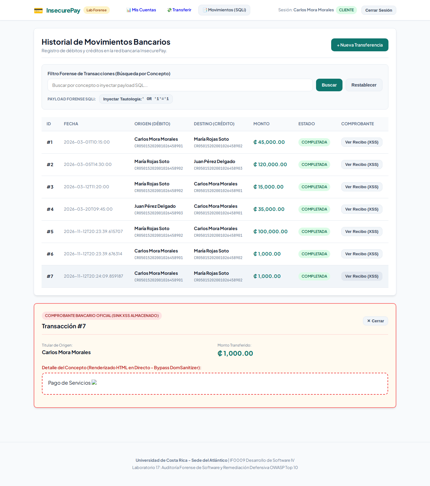
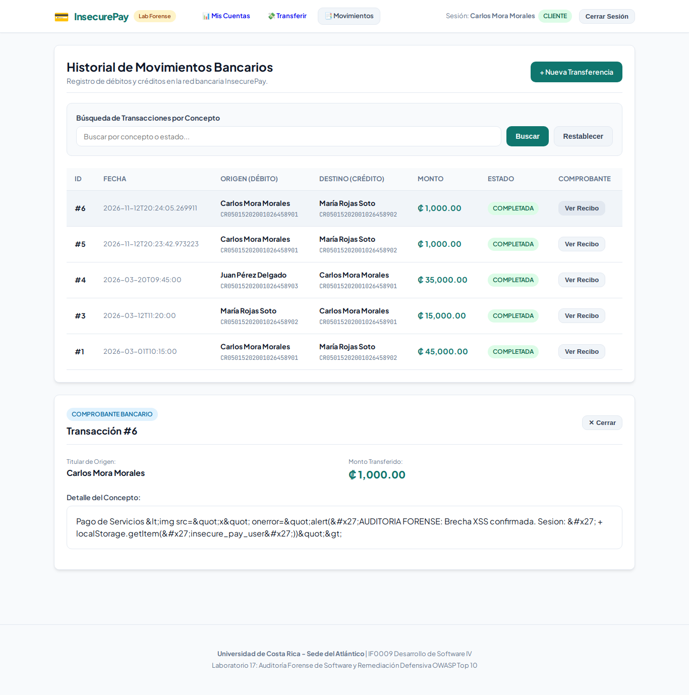

# Bitácora Pericial Forense — InsecurePay

**Curso:** IF0009 – Desarrollo de Software IV · UCR Sede del Atlántico, Recinto Paraíso
**Laboratorio:** 17 – Auditoría Forense de Software, Detección OWASP Top 10 y Remediación Defensiva
**Objeto auditado:** InsecurePay (Spring Boot 3.3.4 / Java 21 + Angular 19, H2 en memoria)
**Estudiante:** Débora Zavala (C5L189)
**Fecha de la auditoría:** 12 de noviembre de 2026

---

## 1. Alcance y cadena de custodia

| Elemento | Detalle |
| :--- | :--- |
| Versión vulnerable (línea base) | Rama `version-vulnerable` (commit `4de11b9`), código original entregado por el profesor sin modificaciones |
| Versión remediada | Rama `main` |
| Entorno de ejecución de las PoC | GitHub Actions `ubuntu-latest`, JDK Temurin 21, Node 20, Chromium (Playwright 1.48) |
| Pipeline reproducible | `.github/workflows/auditoria.yml` (jobs `pruebas`, `evidencias (antes/despues)` y `publicar`) |
| Scripts de explotación | `scripts/poc.sh` (curl + jq) y `scripts/xss-playwright.mjs` (navegador real) |
| Evidencias originales | Carpeta [`evidencias/`](evidencias/) y rama `evidencias-ci` (generada automáticamente por el pipeline) |
| Prueba de regresión | `mvn clean test` → **16 pruebas, 0 fallos** (`InsecurePaySecurityTest`) |

Ambas versiones se ejecutaron con **los mismos scripts** contra la misma base de datos semilla, de modo que la diferencia entre `poc-antes.txt` y `poc-despues.txt` es atribuible exclusivamente a los parches. Los JWT se recortan en las evidencias para no publicar tokens completos.

### Metodología

1. **Reconocimiento:** inventario de endpoints REST (`RootController`), modelo de datos (`schema.sql`) y flujo de sesión del frontend (`auth.service.ts`).
2. **SAST:** revisión manual del código fuente buscando concatenación SQL, comparaciones de credenciales, ausencia de verificación de propiedad, `bypassSecurityTrustHtml` y configuración insegura.
3. **DAST:** ejecución de payloads con `curl` y navegación automatizada con Chromium.
4. **PoC:** demostración controlada del impacto (exfiltración, fraude, robo de sesión).
5. **Registro:** fichas técnicas con CWE, OWASP 2021, CVSS v3.1.
6. **Remediación y verificación:** parche, pruebas automatizadas y re-ejecución idéntica de las PoC.

### Resumen de hallazgos

| ID | Vulnerabilidad | OWASP 2021 | CWE | CVSS v3.1 | Estado |
| :--- | :--- | :--- | :--- | :--- | :--- |
| HALLAZGO-01 | Inyección SQL en búsqueda de transacciones | A03 – Injection | CWE-89 | **8.2 Alta** | Remediado |
| HALLAZGO-02 | IDOR / BOLA en cuentas, saldos y transferencias | A01 – Broken Access Control | CWE-639 / CWE-862 | **8.1 Alta** | Remediado |
| HALLAZGO-03 | Stored XSS en el concepto de transferencias | A03 – Injection | CWE-79 | **8.7 Alta** | Remediado |
| HALLAZGO-04 | Contraseñas almacenadas y comparadas en texto plano | A02 – Cryptographic Failures / A07 | CWE-256 / CWE-916 | **7.4 Alta** | Remediado |
| HALLAZGO-05 | Fuga de trazas técnicas, consola H2 expuesta y secreto JWT débil | A05 – Security Misconfiguration / A02 | CWE-209 / CWE-798 / CWE-321 | **9.8 Crítica** | Remediado |

---

## 2. Fichas técnicas

### HALLAZGO-01 — Inyección SQL en búsqueda de transacciones

| Campo pericial | Especificación técnica |
| :--- | :--- |
| Identificador | HALLAZGO-01 |
| Nombre | Inyección SQL en `GET /api/transacciones/buscar` |
| Clasificación OWASP | A03:2021 – Injection (CWE-89) |
| Severidad CVSS v3.1 | **8.2 Alta** — `AV:N/AC:L/PR:N/UI:N/S:U/C:H/I:L/A:N` |
| Archivo y línea afectada | `backend/src/main/java/cr/ac/ucr/if0009/insecurepay/service/TransaccionService.java` líneas 55–61 (`String sql = ... + termino + ...` y `createNativeQuery(sql, ...)`) |
| Descripción del vector | El parámetro `termino` llega sin validar desde la URL y se concatena dentro de una consulta nativa. Una comilla simple cierra el literal `LIKE` y el resto del texto se interpreta como SQL. El endpoint además no exige autenticación. |
| Prueba de concepto | `curl -G http://localhost:8080/api/transacciones/buscar --data-urlencode "termino=' OR 1=1 --"` y, para exfiltración, `termino=zzz' UNION ALL SELECT id, 2, 3, 0.00, username \|\| ':' \|\| password, TIMESTAMP '2026-01-01 00:00:00', rol FROM USUARIOS --` |
| Impacto de negocio | Lectura de todas las transacciones del banco sin sesión y volcado completo de la tabla `USUARIOS` (usuarios, roles y contraseñas). Pérdida total de confidencialidad. |
| Estrategia de remediación | Consultas JPQL con parámetros con nombre (`:termino`), filtro por propiedad del usuario autenticado, JWT obligatorio y límite de 100 caracteres. |

**Antes (explotación exitosa)** — extracto de [`evidencias/poc-antes.txt`](evidencias/poc-antes.txt):

```text
>>> Payload booleano sin token: ' OR 1=1 --
HTTP 200
{ "total": 4, "registros": [ {"id":1,...}, {"id":2,"origen":"María Rojas Soto","destino":"Juan Pérez Delgado",...}, ... ] }

>>> Volcado de la tabla USUARIOS mediante UNION sobre la busqueda
HTTP 200
{
  "total": 5,
  "credenciales": [
    { "rol": "ADMIN",   "usuario:password": "admin:admin123" },
    { "rol": "AUDITOR", "usuario:password": "auditor_seguridad:auditor2026" },
    { "rol": "CLIENTE", "usuario:password": "carlos_mora:carlos123" },
    { "rol": "CLIENTE", "usuario:password": "maria_rojas:maria123" },
    { "rol": "CLIENTE", "usuario:password": "juan_perez:juan123" }
  ]
}
```

**Después (bloqueo confirmado)** — extracto de [`evidencias/poc-despues.txt`](evidencias/poc-despues.txt):

```text
>>> Payload booleano sin token: ' OR 1=1 --
HTTP 401  { "title": "No autenticado", "detail": "Cabecera de autorizacion invalida." }

>>> Payload booleano con token de carlos_mora: ' OR '1'='1
HTTP 200  { "total": 0, "registros": [] }

>>> Comilla simple aislada en la busqueda
HTTP 200  []
```

El payload se trata como texto literal: no hay coincidencias y no se produce error de sintaxis. La prueba `busquedaEsInmuneAInyeccionSql` verifica además el payload `UNION` (0 resultados).

**Parche aplicado** — `repository/TransaccionRepository.java`:

```java
@Query("SELECT t FROM Transaccion t " +
       "WHERE (LOWER(t.conceptoHtml) LIKE LOWER(CONCAT('%', :termino, '%')) " +
       "    OR LOWER(t.estado) LIKE LOWER(CONCAT('%', :termino, '%'))) " +
       "  AND (t.cuentaOrigen.usuario.id = :usuarioId " +
       "    OR t.cuentaDestino.usuario.id = :usuarioId) " +
       "ORDER BY t.fecha DESC")
List<Transaccion> buscarPorTerminoSeguroDelUsuario(
        @Param("termino") String termino,
        @Param("usuarioId") Long usuarioId);
```

`service/TransaccionService.java`:

```java
public List<TransaccionDto> buscarPorTermino(String termino, String authHeader) {
    Usuario usuario = identidadService.usuarioAutenticado(authHeader);
    if (termino == null || termino.trim().isEmpty()) {
        return List.of();
    }
    String limpio = termino.trim();
    if (limpio.length() > LONGITUD_MAXIMA_TERMINO) {
        throw new SolicitudInvalidaException("El termino de busqueda excede la longitud permitida.");
    }
    List<Transaccion> resultado = identidadService.esPrivilegiado(usuario)
            ? transaccionRepository.buscarPorTerminoSeguro(limpio)
            : transaccionRepository.buscarPorTerminoSeguroDelUsuario(limpio, usuario.getId());
    return resultado.stream().map(this::convertirADto).toList();
}
```

**Justificación:** con *parameter binding* Hibernate envía el término como valor de un `PreparedStatement`, por lo que el motor H2 nunca lo interpreta como sintaxis. Se eliminó por completo `EntityManager.createNativeQuery` y el `System.out` que imprimía la consulta. El filtro por `usuarioId` impide que la búsqueda (aun legítima) devuelva movimientos de terceros; solo `AUDITOR` y `ADMIN` buscan globalmente.

---

### HALLAZGO-02 — IDOR / BOLA en cuentas, saldos y transferencias

| Campo pericial | Especificación técnica |
| :--- | :--- |
| Identificador | HALLAZGO-02 |
| Nombre | Referencia directa insegura a objetos en `/api/cuentas/**`, `/api/transacciones/**` y `POST /api/transacciones/transferir` |
| Clasificación OWASP | A01:2021 – Broken Access Control (CWE-639, CWE-862) |
| Severidad CVSS v3.1 | **8.1 Alta** — `AV:N/AC:L/PR:L/UI:N/S:U/C:H/I:H/A:N` |
| Archivo y línea afectada | `controller/CuentaController.java` líneas 22, 29 y 36; `service/CuentaService.java` líneas 30 y 38; `service/TransaccionService.java` líneas 77–78 (`findById(dto.getCuentaOrigenId())` sin validar propietario); `controller/TransaccionController.java` líneas 22, 27 y 32 |
| Descripción del vector | Los servicios usan el `id` recibido en la URL o en el cuerpo de forma ciega. El backend nunca lee el JWT, así que ni siquiera se requiere sesión. El frontend además lista todas las cuentas del banco como posibles orígenes de una transferencia. |
| Prueba de concepto | `curl http://localhost:8080/api/cuentas/3 -H "Authorization: Bearer <TOKEN_CARLOS>"` y `curl -X POST .../transacciones/transferir -d '{"cuentaOrigenId":3,"numeroCuentaDestino":"CR05015202001026458901","monto":100000,...}'` |
| Impacto de negocio | Exposición de titular, IBAN y saldo de cualquier cliente; **fraude financiero directo**: Carlos debitó ₡100 000 de la cuenta de María hacia la suya. |
| Estrategia de remediación | Identidad extraída y verificada desde el JWT en la capa de servicio; validación estricta de propiedad del recurso (`403 Forbidden`); acceso global solo para roles `AUDITOR`/`ADMIN`; frontend limitado a las cuentas propias. |

**Antes (explotación exitosa):**

```text
>>> carlos_mora consulta la cuenta ID 3 (propiedad de maria_rojas)
HTTP 200  { "id": 3, "titular": "María Rojas Soto", "numeroCuenta": "CR05015202001026458902", "saldo": 4850000.00 }

>>> Listado global de cuentas sin token
HTTP 200  { "total": 4, "cuentas": [ ... saldo 50000000.00, 250000.00, 4850000.00, 75000.00 ] }

>>> carlos_mora debita 100000 CRC desde la cuenta ID 3 de maria_rojas hacia su cuenta CR05015202001026458901
HTTP 201  { "id": 5, "origen": "CR05015202001026458902", "titularOrigen": "María Rojas Soto", "monto": 100000, "estado": "COMPLETADA" }

>>> maria_rojas verifica el saldo de su cuenta ID 3 (saldo inicial 4850000.00)
HTTP 200  { "id": 3, "saldo": 4750000.00 }
```

**Después (bloqueo confirmado):**

```text
>>> carlos_mora consulta la cuenta ID 3 (propiedad de maria_rojas)
HTTP 403  { "title": "Acceso denegado", "detail": "Acceso no autorizado a cuenta ajena." }

>>> carlos_mora consulta el saldo de la cuenta ID 3
HTTP 403  { "title": "Acceso denegado", "detail": "Acceso no autorizado a cuenta ajena." }

>>> carlos_mora lista las cuentas del usuario ID 4 (maria_rojas)
HTTP 403  { "detail": "Acceso no autorizado a cuentas de otro cliente." }

>>> Listado global de cuentas sin token
HTTP 401  { "title": "No autenticado" }

>>> carlos_mora debita 100000 CRC desde la cuenta ID 3 ...
HTTP 403  { "title": "Acceso denegado", "detail": "Fraude detectado: no puede debitar fondos de cuentas ajenas." }

>>> maria_rojas verifica el saldo de su cuenta ID 3 (saldo inicial 4850000.00)
HTTP 200  { "id": 3, "saldo": 4850000.00 }
```

**Parche aplicado** — `service/IdentidadService.java` (identidad verificada desde el JWT):

```java
public Usuario usuarioAutenticado(String authHeader) {
    String usernameAutenticado = jwtUtil.extraerUsername(extraerToken(authHeader));
    return usuarioRepository.findByUsername(usernameAutenticado)
            .orElseThrow(() -> new NoAutenticadoException("Sesion invalida."));
}
```

`service/CuentaService.java`:

```java
public CuentaDto obtenerCuentaSegura(Long cuentaId, String authHeader) {
    Usuario autenticado = identidadService.usuarioAutenticado(authHeader);
    CuentaBancaria cuenta = cuentaRepository.findById(cuentaId)
            .orElseThrow(() -> new RecursoNoEncontradoException("Cuenta bancaria no existe"));
    boolean esPropietario = identidadService.esPropietario(cuenta, autenticado);
    boolean esAuditor = identidadService.esPrivilegiado(autenticado);
    if (!esPropietario && !esAuditor) {
        throw new AccesoDenegadoException("Acceso no autorizado a cuenta ajena.");
    }
    return convertirADto(cuenta);
}
```

`service/TransaccionService.java` (antes de debitar):

```java
if (!cuentaOrigen.getUsuario().getUsername()
        .equalsIgnoreCase(usuarioAutenticado.getUsername())) {
    throw new AccesoDenegadoException(
        "Fraude detectado: no puede debitar " +
        "fondos de cuentas ajenas.");
}
```

**Justificación:** la autorización se decide en el servidor a partir de una identidad firmada (JWT) y no de parámetros controlados por el cliente. Se aplicó el mismo control a todos los endpoints con identificadores (`/cuentas/{id}`, `/cuentas/{id}/saldo`, `/cuentas/usuario/{usuarioId}`, `/transacciones/{id}`, `/transacciones/cuenta/{cuentaId}` y la transferencia). En el frontend se agregó un `HttpInterceptor` que envía `Authorization: Bearer`, un `CanActivate` guard y el selector de origen ahora solo lista cuentas propias. También se agregaron validaciones de negocio (misma moneda, cuentas activas, origen ≠ destino) y la restricción `CHECK (saldo >= 0)` en la base de datos.

---

### HALLAZGO-03 — Stored XSS en el concepto de transferencias

| Campo pericial | Especificación técnica |
| :--- | :--- |
| Identificador | HALLAZGO-03 |
| Nombre | Cross-Site Scripting almacenado en el comprobante de transacción |
| Clasificación OWASP | A03:2021 – Injection (CWE-79) |
| Severidad CVSS v3.1 | **8.7 Alta** — `AV:N/AC:L/PR:L/UI:R/S:C/C:H/I:H/A:N` |
| Archivo y línea afectada | Backend: `service/TransaccionService.java` línea 98 (`setConceptoHtml(dto.getConceptoHtml())`); `schema.sql` línea 34 (`concepto_html CLOB`). Frontend: `transacciones.component.ts` línea 82 (`bypassSecurityTrustHtml`) y `transacciones.component.html` línea 101 (`[innerHTML]`) |
| Descripción del vector | El concepto se persiste sin desinfección y el frontend desactiva explícitamente el sanitizador DOM de Angular al renderizarlo con `[innerHTML]`. Cualquier usuario que abra el comprobante ejecuta el script del atacante. |
| Prueba de concepto | Transferencia con concepto `Pago de Servicios ` y apertura de **Ver Recibo** en el navegador (automatizado con Playwright). |
| Impacto de negocio | Robo de la sesión completa (incluido el JWT almacenado en `localStorage`), suplantación de la víctima y ejecución de transferencias en su nombre; persistente para todo auditor o cliente que vea el comprobante. |
| Estrategia de remediación | Eliminación de `bypassSecurityTrustHtml`/`[innerHTML]` y uso de interpolación `{{ }}`; escape HTML en el backend antes de persistir (defensa en profundidad); límite de 250 caracteres; datos semilla convertidos a texto plano. |

**Antes (ejecución confirmada en Chromium)** — [`evidencias/xss-antes.txt`](evidencias/xss-antes.txt):

```text
Comprobante abierto: transaccion #7
Elementos  inyectados en el DOM: 1
RESULTADO: JavaScript ejecutado en el navegador de la victima.
alert() -> AUDITORIA FORENSE: Brecha XSS confirmada. Sesion: {"token":"eyJhbGciOiJIUzI1NiJ9...[recortado]","username":"carlos_mora",...,"usuarioId":3}
```

Respuesta del API (`poc-antes.txt`): el concepto se almacena literalmente como `Pago de Servicios `.



**Después (bloqueo confirmado)** — [`evidencias/xss-despues.txt`](evidencias/xss-despues.txt):

```text
Comprobante abierto: transaccion #6
Elementos  inyectados en el DOM: 0
RESULTADO: No se ejecuto JavaScript; el concepto se renderizo como texto plano.
```

Respuesta del API (`poc-despues.txt`): `"conceptoHtml": "Pago de Servicios &lt;img src=&quot;x&quot; onerror=&quot;alert(&#x27;AUDITORIA FORENSE: ..."`.



**Parche aplicado** — `transacciones.component.html`:

```html
<div class="comprobante-concepto">{{ transaccionSeleccionada.conceptoHtml }}</div>
```

`transacciones.component.ts`: se eliminaron la inyección de `DomSanitizer`, la propiedad `conceptoSeguro: SafeHtml` y la llamada a `bypassSecurityTrustHtml`.

`service/TransaccionService.java`:

```java
private String sanitizarTexto(String entrada) {
    if (entrada == null) return "";
    return entrada.trim()
        .replace("&", "&amp;")
        .replace("<", "&lt;")
        .replace(">", "&gt;")
        .replace("\"", "&quot;")
        .replace("'", "&#x27;");
}
```

**Justificación:** la interpolación de Angular codifica `<`, `>` y `"` antes de insertar en el DOM, por lo que el navegador nunca crea el elemento ``. El escape en el backend garantiza que el dato persistido sea inofensivo para cualquier otro consumidor del API (otro frontend, reportes, correos). Como mejora residual se recomienda migrar el JWT de `localStorage` a una cookie `HttpOnly; Secure; SameSite=Strict` y publicar una cabecera `Content-Security-Policy`.

---

### HALLAZGO-04 — Contraseñas almacenadas y validadas en texto plano

| Campo pericial | Especificación técnica |
| :--- | :--- |
| Identificador | HALLAZGO-04 |
| Nombre | Almacenamiento inseguro de credenciales y enumeración de usuarios |
| Clasificación OWASP | A02:2021 – Cryptographic Failures / A07:2021 – Identification and Authentication Failures (CWE-256, CWE-916, CWE-204) |
| Severidad CVSS v3.1 | **7.4 Alta** — `AV:N/AC:H/PR:N/UI:N/S:U/C:H/I:H/A:N` |
| Archivo y línea afectada | `service/AuthService.java` línea 27 (`usuario.getPassword().equals(request.getPassword())`) y línea 25 (mensaje que revela si el usuario existe); `resources/data.sql` líneas 7–11; `resources/schema.sql` línea 12 |
| Descripción del vector | Las contraseñas se guardan sin función de derivación y se comparan con `String.equals`. Cualquier acceso de lectura a la base (consola H2, inyección SQL, respaldo filtrado) entrega las credenciales utilizables. El login responde distinto cuando el usuario no existe. |
| Prueba de concepto | Volcado `UNION` del HALLAZGO-01 y `curl -X POST /api/auth/login -d '{"username":"usuario_fantasma","password":"x"}'` |
| Impacto de negocio | Toma de control de todas las cuentas, incluidas `admin` y `auditor_seguridad`; reutilización de contraseñas en otros sistemas; enumeración de clientes válidos. |
| Estrategia de remediación | `BCryptPasswordEncoder` (factor 12) como `@Bean`, hashes `$2a$12$` en `data.sql`, validación exclusiva con `passwordEncoder.matches`, mensaje genérico, hash señuelo contra ataques de temporización y restricción `CHECK` en la tabla. |

**Antes:**

```text
>>> Login con usuario inexistente (enumeracion de usuarios)
HTTP 500  { "message": "Usuario no encontrado en InsecurePay: usuario_fantasma", "trace": "java.lang.RuntimeException: ..." }

>>> Volcado de la tabla USUARIOS mediante UNION sobre la busqueda
"admin:admin123", "auditor_seguridad:auditor2026", "carlos_mora:carlos123", "maria_rojas:maria123", "juan_perez:juan123"
```

**Después:**

```text
>>> Login con usuario inexistente (enumeracion de usuarios)
HTTP 401  { "title": "No autenticado", "detail": "Credenciales invalidas." }
```

`data.sql` remediado (extracto):

```sql
('carlos_mora', '$2a$12$ccth/Fk1Z7f3uqYgZ2EbRO31iYjwpeeLSoSYIxk1hPYjmOlpaTLT2', 'Carlos Mora Morales', 'cmora@correo.cr', 'CLIENTE'),
```

Las pruebas `contrasenasPersistidasConBcryptFactorMinimoDiez` y `loginValidoConBcryptEmiteToken` confirman que los 5 usuarios tienen hash BCrypt con factor ≥ 10 y que el login sigue funcionando.

**Parche aplicado** — `config/SecurityConfig.java`:

```java
@Bean
public PasswordEncoder passwordEncoder(@Value("${app.security.bcrypt-strength:12}") int fuerza) {
    if (fuerza < 10) {
        throw new IllegalStateException("El factor de trabajo de BCrypt debe ser 10 o superior.");
    }
    return new BCryptPasswordEncoder(BCryptPasswordEncoder.BCryptVersion.$2A, fuerza);
}
```

`service/AuthService.java`:

```java
public LoginResponse autenticar(LoginRequest request) {
    Optional<Usuario> encontrado = usuarioRepository.findByUsername(request.getUsername());
    String hashAlmacenado = encontrado.map(Usuario::getPassword).orElse(hashSenuelo);
    boolean coincide = passwordEncoder.matches(request.getPassword(), hashAlmacenado);
    if (encontrado.isEmpty() || !coincide) {
        throw new CredencialesInvalidasException(MENSAJE_GENERICO);
    }
    ...
}
```

`schema.sql`:

```sql
CONSTRAINT ck_password_bcrypt CHECK (password LIKE '$2_$__$%' AND LENGTH(password) = 60)
```

**Justificación:** BCrypt incorpora sal aleatoria y un costo configurable (2¹² iteraciones), lo que vuelve inviable revertir los hashes aun si la base se filtra. Siempre se ejecuta `matches` (contra un hash señuelo si el usuario no existe), por lo que el tiempo de respuesta no revela qué usuarios existen. La restricción `CHECK` impide que una contraseña en texto plano llegue a persistirse por error. Se eliminaron del frontend los botones que mostraban usuarios y contraseñas de prueba. En tránsito, la contraseña solo viaja en el cuerpo del `POST /login`; en producción ese canal debe ir sobre HTTPS/TLS.

---

### HALLAZGO-05 — Fuga de trazas técnicas, consola H2 expuesta y secreto JWT débil

| Campo pericial | Especificación técnica |
| :--- | :--- |
| Identificador | HALLAZGO-05 |
| Nombre | Configuración insegura: stack traces públicos, consola H2 abierta, CORS `*` y secreto JWT quemado en el repositorio |
| Clasificación OWASP | A05:2021 – Security Misconfiguration / A02:2021 (CWE-209, CWE-215, CWE-798, CWE-321) |
| Severidad CVSS v3.1 | **9.8 Crítica** por la consola H2 sin credenciales (`AV:N/AC:L/PR:N/UI:N/S:U/C:H/I:H/A:H`); la fuga de trazas aislada se califica 5.3 Media (`AV:N/AC:L/PR:N/UI:N/S:U/C:L/I:N/A:N`) |
| Archivo y línea afectada | `resources/application.properties` líneas 15–17 (H2 console), 28–29 (`include-message`/`include-stacktrace=always`) y 34 (`jwt.secret`); `util/JwtUtil.java` línea 18; `config/CorsConfig.java` línea 15 |
| Descripción del vector | Cualquier excepción devuelve la traza completa, nombres de clases y la sentencia SQL. La consola H2 acepta conexiones remotas con usuario `sa` sin contraseña. El secreto HMAC del JWT está publicado en el repositorio, lo que permite forjar tokens. |
| Prueba de concepto | `curl -G .../buscar --data-urlencode "termino='"`, `curl .../cuentas/abc`, `curl .../h2-console/` y un JWT forjado con `ClaveSecretaSuperDebilInsecurePayBanco2026` |
| Impacto de negocio | Reconocimiento detallado de la arquitectura (Hibernate, H2, estructura SQL) que facilita otros ataques; control total de la base de datos mediante la consola; suplantación de cualquier usuario con tokens forjados. |
| Estrategia de remediación | `include-stacktrace=never`, `include-message=never`, `@RestControllerAdvice` con respuestas RFC 7807 (`ProblemDetail`), consola H2 deshabilitada, `show-sql=false`, secreto JWT externalizado en `INSECUREPAY_JWT_SECRET` con validación de ≥ 256 bits y CORS restringido. |

**Antes:**

```text
>>> Comilla simple aislada en la busqueda
HTTP 500
"trace": "org.hibernate.exception.DataException: could not prepare statement [...] SQL statement:
SELECT * FROM TRANSACCIONES WHERE concepto_html LIKE '%'%' OR estado LIKE '%'%' [90008-224]] ..."

>>> Identificador no numerico en /api/cuentas/{id}
HTTP 400  "trace": "org.springframework.web.method.annotation.MethodArgumentTypeMismatchException: ... 'java.lang.Long' ..."

>>> Exposicion de la consola H2
HTTP 200

>>> Token JWT forjado para maria_rojas con la clave publicada en application.properties
HTTP 200  { "titular": "María Rojas Soto", "saldo": 4751000.00 }
```

**Después:**

```text
>>> Comilla simple aislada en la busqueda
HTTP 200  []

>>> Identificador no numerico en /api/cuentas/{id}
HTTP 400
{
  "type": "https://insecurepay.ucr.ac.cr/problemas/parametro-invalido",
  "title": "Solicitud invalida",
  "status": 400,
  "detail": "Uno o mas parametros tienen un formato invalido.",
  "instance": "/api/cuentas/abc",
  "timestamp": "2026-11-12T20:19:39.604609789Z"
}

>>> Cuerpo JSON malformado en /api/transacciones/transferir
HTTP 400  { "type": ".../cuerpo-invalido", "detail": "El cuerpo de la solicitud no es valido." }

>>> Exposicion de la consola H2
HTTP 404

>>> Token JWT forjado para maria_rojas con la clave publicada en application.properties
HTTP 401  { "title": "No autenticado", "detail": "Token invalido o expirado." }
```

**Parche aplicado** — `application.properties`:

```properties
spring.h2.console.enabled=false
spring.jpa.show-sql=false
server.error.include-message=never
server.error.include-stacktrace=never
server.error.include-binding-errors=never
server.error.include-exception=false
spring.mvc.problemdetails.enabled=true
jwt.secret=${INSECUREPAY_JWT_SECRET:}
app.cors.allowed-origins=${INSECUREPAY_CORS_ORIGINS:http://localhost:4200}
```

`exception/GlobalExceptionHandler.java` (extracto):

```java
@RestControllerAdvice
public class GlobalExceptionHandler extends ResponseEntityExceptionHandler {

    @ExceptionHandler(AccesoDenegadoException.class)
    public ProblemDetail accesoDenegado(AccesoDenegadoException ex, HttpServletRequest req) {
        return problema(HttpStatus.FORBIDDEN, "acceso-denegado", "Acceso denegado", ex.getMessage(), req);
    }

    @ExceptionHandler(Exception.class)
    public ProblemDetail errorInterno(Exception ex, HttpServletRequest req) {
        String incidente = UUID.randomUUID().toString();
        log.error("Incidente {} en {} {}", incidente, req.getMethod(), req.getRequestURI(), ex);
        ProblemDetail pd = problema(HttpStatus.INTERNAL_SERVER_ERROR, "error-interno", "Error interno",
                "Ocurrio un error inesperado. Reporte el codigo de incidente a soporte.", req);
        pd.setProperty("incidente", incidente);
        return pd;
    }
}
```

`util/JwtUtil.java`:

```java
if (secret == null || secret.isBlank()) {
    throw new IllegalStateException("Debe definir la variable de entorno INSECUREPAY_JWT_SECRET.");
}
byte[] bytes = secret.getBytes(StandardCharsets.UTF_8);
if (bytes.length < LONGITUD_MINIMA_BYTES) {
    throw new IllegalStateException("INSECUREPAY_JWT_SECRET debe tener al menos 256 bits (32 bytes).");
}
```

**Justificación:** el cliente recibe únicamente un `ProblemDetail` estandarizado (RFC 7807) con un mensaje controlado; la traza completa queda solo en el log del servidor, correlacionada por un código de incidente. La aplicación se niega a iniciar sin un secreto fuerte (*fail fast*), por lo que el secreto ya no puede quedar en el código fuente; los tokens firmados con la clave filtrada se rechazan (`tokenFirmadoConLaClaveFiltradaEsRechazado`). Los tokens ahora incluyen `iss` verificado y expiran en 1 hora (antes 24 h). CORS solo admite el origen del frontend y los métodos/cabeceras necesarios.

---

## 3. Verificación automatizada

Resultado de `mvn clean test` en el pipeline:

```text
[INFO] Tests run: 16, Failures: 0, Errors: 0, Skipped: 0, Time elapsed: 8.237 s -- in cr.ac.ucr.if0009.insecurepay.InsecurePaySecurityTest
[INFO] BUILD SUCCESS
```

| Prueba | Hallazgo verificado |
| :--- | :--- |
| `busquedaEsInmuneAInyeccionSql` | 01 |
| `busquedaLegitimaSoloRetornaTransaccionesPropias` | 01, 02 |
| `endpointsSinTokenRetornan401` | 01, 02 |
| `listadoDeCuentasSoloIncluyeLasPropias` | 02 |
| `consultaDeCuentaAjenaRetorna403` | 02 |
| `consultaDeCuentaPropiaRetorna200` | 02 |
| `auditorPuedeConsultarCuentasDeTerceros` | 02 |
| `transferenciaDesdeCuentaAjenaRetorna403YNoDebita` | 02 |
| `transaccionAjenaRetorna403` | 02 |
| `conceptoConHtmlSePersisteEscapado` | 03 |
| `loginValidoConBcryptEmiteToken` | 04 |
| `loginInvalidoRetornaProblemDetailGenericoSinEnumerarUsuarios` | 04, 05 |
| `contrasenasPersistidasConBcryptFactorMinimoDiez` | 04 |
| `erroresNoExponenTrazasNiDetallesInternos` | 05 |
| `secretoJwtCortoOAusenteEsRechazado` | 05 |
| `tokenFirmadoConLaClaveFiltradaEsRechazado` | 05 |

## 4. Lista de verificación de entrega

- [x] Backend compila sin errores (`mvn clean test`).
- [x] Búsqueda de transacciones utiliza JPQL parametrizado y es invulnerable a `' OR 1=1 --`.
- [x] Endpoints de cuentas y transferencias bloquean solicitudes IDOR con HTTP 403 Forbidden.
- [x] El concepto de transferencia no ejecuta scripts maliciosos en la vista de comprobantes.
- [x] Las contraseñas en `data.sql` están codificadas con BCrypt y el login funciona correctamente.
- [x] `application.properties` no expone trazas de stack ni detalles internos ante errores HTTP 500.
- [x] Bitácora pericial de los 5 hallazgos documentada con evidencias antes/después.

## 5. Riesgos residuales y recomendaciones

1. Migrar el JWT de `localStorage` a cookie `HttpOnly` y agregar `Content-Security-Policy` para mitigar el impacto de cualquier XSS futuro.
2. Incorporar Spring Security con un filtro JWT centralizado y `@PreAuthorize` para no depender de la verificación manual en cada servicio.
3. Desplegar exclusivamente sobre HTTPS y agregar limitación de intentos (*rate limiting*) en `/api/auth/login`.
4. Usar bloqueo optimista o pesimista sobre `CUENTAS_BANCARIAS` para evitar condiciones de carrera en transferencias concurrentes.
5. Gestionar `INSECUREPAY_JWT_SECRET` en un gestor de secretos (Vault, GitHub Secrets) y rotarlo periódicamente.
